# Sơ Đồ Thực Thể Quan Hệ (Entity-Relationship Diagram - ERD)
`docs/architecture/erd.md`

Sơ đồ ERD mô hình hóa toàn diện các thực thể dữ liệu và mối liên kết khóa ngoại giữa các module trong hệ thống GPLX Training System (được đối chiếu và chuẩn hóa 100% với MySQL 8.4 LTS runtime schema):

```mermaid
erDiagram
    users ||--o{ user_roles : "gán vai trò"
    roles ||--o{ user_roles : "thuộc người dùng"
    roles ||--o{ role_permissions : "chứa quyền"
    permissions ||--o{ role_permissions : "gán vào vai trò"

    users ||--o{ applications : "nộp hồ sơ"
    license_categories ||--o{ applications : "đăng ký hạng"
    applications ||--o{ application_documents : "đính kèm"
    applications ||--o{ application_status_history : "lịch sử xét duyệt"

    license_categories ||--o{ courses : "chương trình đào tạo"
    courses ||--o{ course_lessons : "bài giảng lý thuyết"
    users ||--o{ learning_progress : "học viên"
    course_lessons ||--o{ learning_progress : "bài học"
    theory_questions ||--o{ theory_answers : "phương án trả lời"

    courses ||--o{ training_classes : "mở lớp đào tạo"
    users ||--o{ training_classes : "giáo viên chủ nhiệm"
    training_classes ||--o{ class_enrollments : "danh sách lớp"
    users ||--o{ class_enrollments : "học viên"
    training_classes ||--o{ training_schedules : "thời khóa biểu"
    users ||--o{ training_schedules : "giáo viên phụ trách"
    training_schedules ||--o{ attendance_records : "điểm danh ca học"

    users ||--o{ dat_practice_sessions : "học viên"
    users ||--o{ dat_practice_sessions : "giáo viên giám sát"

    license_categories ||--o{ exam_sessions : "hạng sát hạch"
    exam_sessions ||--o{ exam_candidates : "danh sách thi"
    users ||--o{ exam_candidates : "thí sinh"
    exam_candidates ||--|| exam_results : "kết quả sát hạch"
    users ||--o{ exam_results : "sát hạch viên chấm"

    users ||--o{ fee_invoices : "học viên nợ phí"
    license_categories ||--o{ fee_invoices : "biểu phí theo hạng"
    fee_invoices ||--o{ payment_receipts : "thanh toán"

    license_categories ||--o{ vehicles : "hạng xe tập lái"
    vehicles ||--o{ vehicle_maintenances : "nhật ký bảo dưỡng"

    users ||--o{ audit_logs : "người thực hiện"
    users ||--o{ notifications : "người nhận"
    users ||--o{ crm_leads : "tư vấn viên"

    users {
        bigint id PK
        varchar username UK
        varchar email UK
        varchar password_hash
        varchar full_name
        varchar phone
        tinyint is_active
        datetime created_at
        datetime updated_at
    }

    roles {
        bigint id PK
        varchar name UK
        varchar description
        datetime created_at
        datetime updated_at
    }

    permissions {
        bigint id PK
        varchar name UK
        varchar description
        varchar module
        datetime created_at
        datetime updated_at
    }

    license_categories {
        bigint id PK
        varchar code UK
        varchar name
        int min_age
        decimal tuition_fee
        tinyint is_active
        datetime created_at
        datetime updated_at
    }

    applications {
        bigint id PK
        varchar application_code UK
        bigint user_id FK
        bigint category_id FK
        varchar full_name
        varchar national_id
        date date_of_birth
        varchar status
        text rejection_reason
        bigint reviewed_by FK
        bigint version
        datetime created_at
        datetime updated_at
    }

    application_documents {
        bigint id PK
        bigint application_id FK
        varchar document_type
        varchar file_name
        varchar file_url
        bigint file_size
        varchar mime_type
        datetime created_at
    }

    courses {
        bigint id PK
        varchar course_code UK
        varchar name
        bigint category_id FK
        text description
        int total_hours
        tinyint is_active
        datetime created_at
        datetime updated_at
    }

    training_classes {
        bigint id PK
        varchar class_code UK
        varchar name
        bigint course_id FK
        bigint instructor_id FK
        int max_students
        date start_date
        date end_date
        varchar status
        datetime created_at
        datetime updated_at
    }

    class_enrollments {
        bigint id PK
        bigint class_id FK
        bigint user_id FK
        varchar status
        datetime enrolled_at
        datetime created_at
        datetime updated_at
    }

    training_schedules {
        bigint id PK
        bigint class_id FK
        bigint instructor_id FK
        varchar schedule_type
        varchar title
        varchar location
        varchar status
        datetime start_time
        datetime end_time
        datetime created_at
        datetime updated_at
    }

    dat_practice_sessions {
        bigint id PK
        bigint user_id FK
        bigint instructor_id FK
        varchar session_type
        decimal distance_km
        int duration_minutes
        varchar status
        varchar device_id
        text note
        datetime start_time
        datetime end_time
        datetime created_at
        datetime updated_at
    }

    exam_sessions {
        bigint id PK
        varchar session_code UK
        bigint category_id FK
        varchar exam_type
        date exam_date
        varchar location
        varchar status
        datetime created_at
        datetime updated_at
    }

    exam_candidates {
        bigint id PK
        bigint exam_session_id FK
        bigint user_id FK
        varchar candidate_number UK
        varchar status
        text disqualification_reason
        datetime registered_at
        datetime created_at
        datetime updated_at
    }

    exam_results {
        bigint id PK
        bigint candidate_id FK
        bigint examiner_id FK
        int theory_score
        tinyint theory_passed
        int simulation_score
        tinyint simulation_passed
        int yard_score
        tinyint yard_passed
        int road_score
        tinyint road_passed
        varchar final_result
        text examiner_note
        datetime graded_at
        datetime created_at
        datetime updated_at
    }

    fee_invoices {
        bigint id PK
        varchar invoice_code UK
        bigint user_id FK
        bigint category_id FK
        decimal total_amount
        decimal paid_amount
        varchar status
        date due_date
        datetime created_at
        datetime updated_at
    }

    payment_receipts {
        bigint id PK
        varchar receipt_code UK
        bigint invoice_id FK
        decimal amount
        varchar payment_method
        varchar idempotency_key UK
        datetime paid_at
        datetime created_at
        datetime updated_at
    }

    vehicles {
        bigint id PK
        varchar plate_number UK
        varchar model
        bigint category_id FK
        varchar transmission
        varchar status
        date inspection_expiry_date
        datetime created_at
        datetime updated_at
    }

    vehicle_maintenances {
        bigint id PK
        bigint vehicle_id FK
        date maintenance_date
        varchar description
        decimal cost
        varchar performed_by
        datetime created_at
        datetime updated_at
    }

    audit_logs {
        bigint id PK
        bigint user_id FK
        varchar username
        varchar action
        varchar resource_type
        varchar resource_id
        text details
        varchar ip_address
        datetime created_at
    }
```

