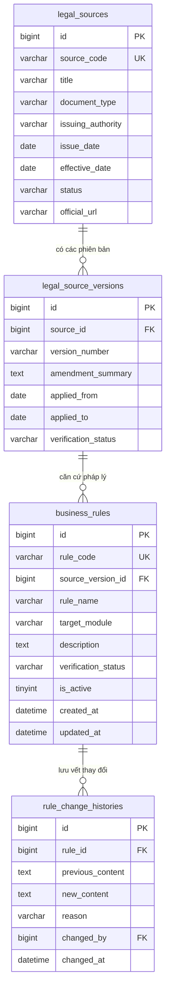

# Thiết Kế Cơ Chế Quản Lý Quy Tắc Có Phiên Bản (Rule Versioning Design)
`docs/architecture/rule-versioning-design.md`

Tài liệu này đánh giá kiến trúc và đề xuất phương án quản lý phiên bản quy tắc nghiệp vụ & pháp lý trong hệ thống GPLX Training System.

---

## 1. Đánh Giá Kiến Trúc: Lưu Trữ CSDL vs. Danh Mục Markdown

### 1.1. So sánh hai phương án tiếp cận

| Tiêu Chí Đánh Giá | Phương Án A: Quản Lý Bằng Markdown Catalog (Git) | Phương Án B: Quản Lý Bằng Bảng Dữ Liệu Trong CSDL |
| :--- | :--- | :--- |
| **Bản chất** | Coi quy tắc là mã nguồn (Rules as Code), theo dõi qua Git Commit / Pull Request. | Đưa toàn bộ điều khoản pháp luật và quy tắc nghiệp vụ thành các bảng thực thể trong MySQL. |
| **Ưu điểm** | - Dễ kiểm soát phiên bản qua Git Flow, commit hash rõ ràng. - Nhẹ, không làm phình to schema CSDL đồ án. - Không tạo gánh nặng quản trị CRUD trên giao diện UI cho quy tắc pháp luật. - Phù hợp hoàn hảo với quy mô đồ án tốt nghiệp Modular Monolith. | - Cho phép Quản trị viên thay đổi quy tắc động tại runtime qua giao diện Web mà không cần build lại mã nguồn. - Khả năng truy vấn SQL trực tiếp để kiểm tra phiên bản quy tắc áp dụng tại thời điểm giao dịch. |
| **Nhược điểm** | Thay đổi quy tắc cần commit tài liệu mới vào Git. | - Tăng độ phức tạp kiến trúc không cần thiết (Over-engineering). - Nguy cơ người dùng sửa sai quy tắc pháp luật đã được xác minh (`VERIFIED`). - Cần xây dựng toàn bộ hệ thống phê duyệt (Approval Workflow) đa cấp. |

### 1.2. Kết luận & Quyết định Kiến Trúc (ADR)
> [!IMPORTANT]
> **Quyết định Kết Hợp Tối Ưu (Hybrid Architecture):**
> 1. **Tầng Tài Liệu & Tri Thức (Documentation & Static Verification):**
>    - Duy trì hệ thống Sổ đăng ký Markdown chuẩn hóa tại `docs/legal/` (`legal-source-catalog.md`, `legal-rule-catalog.md`, `legal-database-traceability.md`) làm **Single Source of Truth** cho đội ngũ phát triển, AI Coding Assistant và hội đồng chấm đồ án.
> 2. **Tầng Tham Số Nghiệp Vụ Động (Runtime Dynamic Parameters):**
>    - Các tham số quy tắc có khả năng thay đổi theo thời gian hoặc theo từng cơ sở (Mức học phí `tuition_fee`, độ tuổi `min_age`, chỉ tiêu km DAT `target_distance_km`, điểm đạt lý thuyết) được lưu trữ trực tiếp trong các cột cấu hình của bảng nghiệp vụ (`license_categories`, `courses`) kèm phiên bản và audit fields (`created_at`, `updated_at`).

---

## 2. Thiết Kế Lược Đồ CSDL Khi Mở Rộng Trong Tương Lai (Proposed Schema)

Trong giai đoạn mở rộng phục vụ quy mô toàn quốc hoặc liên thông cơ quan quản lý nhà nước (Bộ GTVT / Cục ĐBVN), hệ thống có thể bổ sung các bảng quản trị quy tắc chuyên biệt sau:

### Nguyên tắc bảo vệ dữ liệu quy tắc:
1. **Phân quyền tối cao:** Chỉ tài khoản có thẩm quyền cấp cao (`ROLE_ADMIN`) mới có quyền truy cập module quản lý quy tắc.
2. **Khóa bất biến quy tắc đã duyệt:** Mọi quy tắc ở trạng thái `VERIFIED` khi sửa đổi bắt buộc phải tạo bản ghi mới (New Version) và chuyển bản ghi cũ sang `SUPERSEDED`, không ghi đè tại chỗ.
3. **Audit Trail đầy đủ:** Mọi thao tác thay đổi trạng thái xác minh phải được lưu vết tự động vào `audit_logs` với đầy đủ địa chỉ IP và danh tính người thực hiện.
